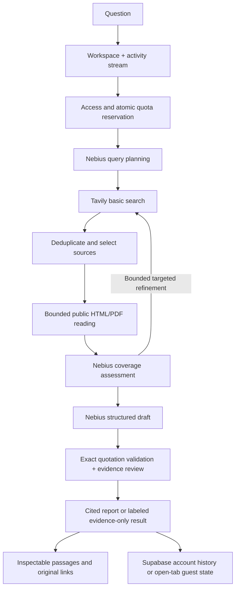

# Fieldwork architecture

Next.js 15 / React 19 / TypeScript; Cloudflare Workers with OpenNext hosts the deployed server. The original Python starter under `docs/template-starter` is provenance, not the running application.

`src/lib/research/pipeline.ts` gathers evidence through planning, coverage, refinement, deduplication and bounded source reading. At most three basic Tavily searches run per turn. Body retrieval has byte/page/time limits. Excerpts are not relabeled as full papers. Relevant prior evidence can be reused within bounds; time-sensitive questions receive separate treatment.

`report-draft.ts` prepares items independently. The existing model review can locate missing quotations in allowed passages. `verified-draft.ts` keeps approved items with valid proof; `validate-report.ts` strictly validates the final report. Approval alone does not prove a quotation exists. Evidence-only fallback never recycles unsupported draft prose.

Provider adapters use actual Token Factory/Tavily APIs. Nebius uses native web fetch, finite timeouts and zero automatic retries. SSE includes heartbeats. Activity records actions/coverage, not private chain-of-thought. Source text remains untrusted data.

Authenticated requests reserve Supabase capacity transactionally. RLS isolates conversations, projects, sources and activity. Google OAuth uses Supabase callbacks; no Google client secret is placed in browser source.

Hosted guests have signed cookies and D1 limits: three questions/guest/UTC day, five/network/UTC day and twenty shared launch questions total. Conservative provider exposure is reserved per paid request. Network keys do not store raw IP addresses. Answers stay in the open tab and are not migrated by signing in. Optional judge access has its own code/session and persistent allowance; missing quota state fails closed. Refreshing or deleting conversations does not reset reservations.

Projects supports assignments, Crossref metadata discovery, text PDF extraction, selected-paper comparison/Q&A, draft claims, notes and exports. Quotations link to extracted page positions. Original uploaded PDFs stay in the browser; extracted text/analyses can be account-saved. Scanned documents require external OCR.

The newspaper/paint/outline presentation adapts owner-supplied Originkit components; it does not supply research evidence. Third-party notices retain component, font, paper and citation-style credits.
